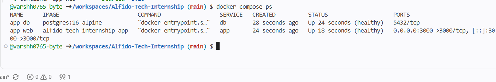
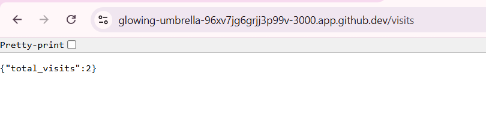

# Dockerized Node.js + PostgreSQL App

A small Express API that records visits in a PostgreSQL database, containerized with a
multi-stage Dockerfile and orchestrated with Docker Compose.

## Project structure

```
.
├── src/server.js         # Express app
├── package.json
├── Dockerfile            # Multi-stage build (deps -> runtime)
├── docker-compose.yml    # App + PostgreSQL
├── .dockerignore
├── .env.example          # Copy to .env
└── README.md
```

## Endpoints

| Route      | Description                                   |
|------------|-----------------------------------------------|
| `/`        | Hello message                                 |
| `/health`  | Health check (verifies DB connectivity)       |
| `/visits`  | Inserts a visit row, returns the total count  |

## Prerequisites

- Docker 24+ and Docker Compose v2 (`docker compose version`)

## Run with Docker Compose (app + DB)

```bash
cp .env.example .env        # edit credentials if you like
docker compose up --build -d
docker compose ps           # both containers should be running / healthy
```

Test it:

```bash
curl http://localhost:3000/
curl http://localhost:3000/health
curl http://localhost:3000/visits    # run repeatedly; the count increases
```

View logs / stop:

```bash
docker compose logs -f app
docker compose down          # stop, keep data
docker compose down -v       # stop and delete the database volume
```

## Build and run the image on its own

```bash
docker build -t node-docker-app .
docker run --rm -p 3000:3000 \
  -e DB_HOST=<db-host> -e DB_USER=appuser -e DB_PASSWORD=apppass -e DB_NAME=appdb \
  node-docker-app
```

(The app needs a reachable PostgreSQL, so Compose is the easiest route.)

## Dockerfile design

- **Stage 1 (`deps`)**: installs production dependencies only.
- **Stage 2 (`runtime`)**: copies `node_modules` and source into a clean alpine image,
  runs as the non-root `node` user, and defines a `HEALTHCHECK`.
- `.dockerignore` keeps the build context small and keeps `.env` out of the image.

## Verify persistence

```bash
curl localhost:3000/visits
docker compose restart
curl localhost:3000/visits   # count continues, data lives in the `pgdata` volume
```

## Screenshots

### Containers running


### Endpoint output


## Publish to GitHub

```bash
git init
git add .
git commit -m "Containerize Node app with Docker and Compose"
git branch -M main
git remote add origin https://github.com/<your-username>/docker-node-app.git
git push -u origin main
```
